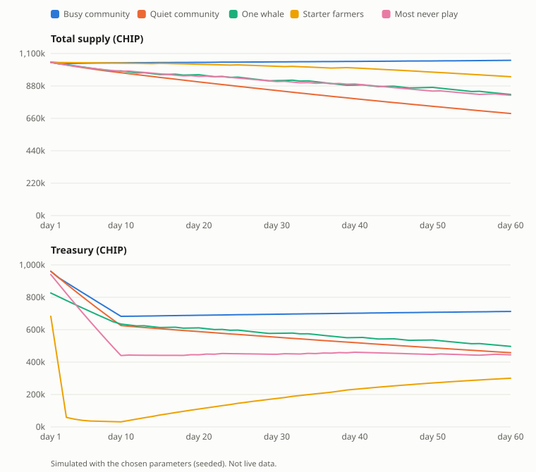

# CHIP on NEAR

CHIP is a NEP-141 memecoin whose own contract is a poker table. Players stake CHIP, each secretly
picks a coin traded on NEAR (a NEAR memecoin, or a busy pool such as wNEAR), and the pick with the
best price move over the round takes the pot. Every
pot burns part of itself, every UTC day either mints or burns depending on how much the community
played, and holders who sit out pay blinds. The meme is poker, and every rule behaves like poker.

Built during NEAR Hackathon (window opened 2026-10-19). Tracks: `memecoins`, `games`.
Team: Israel Dominic (lead developer: contract, backend, integration) and Benita Ukachi (frontend,
social media posting and the demo).

## What was built in the hackathon

- `near/chip`: the CHIP contract (Rust, near-sdk 5.30.1). NEP-141 token, NEP-145 storage,
  NEP-148 metadata, the tables, the three mechanics and the refunds, in one contract.
- `src/adapters/near`: the NEAR client (near-api-js 7.4.0) and the NEAR market price feed (one pinned pool per coin).
- `src/backend/near`: the settler, the House and the pick store for NEAR mode, off unless
  `KOVA_NEAR_ENABLED=true`.
- `src/features/near`, `src/app/near`: the NEAR play screen and the token page, served on the
  `near.*` host. kova.surf is unchanged.
- `scripts/near`: the 60-day simulation and the end-to-end proof script.

Everything else in this repository was built before the hackathon for Solana and is not part of
this entry.

## The contract on testnet

| | |
| --- | --- |
| Contract | [`chip.kingizie.testnet`](https://testnet.nearblocks.io/address/chip.kingizie.testnet) |
| Deploy and init | [one transaction](https://testnet.nearblocks.io/txns/F5YrfUrMmJDNdkfsaNAMbgknEWGMApzfC7ViWeWJbJmz) |
| Code | `near/chip/res/kova_chip.wasm`, sha256 `537076245fd7dbdb27c83c3b432d381f60ad172bed2bceae1a6bcedb61e29617` (bs58 code hash `6ciJReAW4Qktk4NLrw6hAyh6s9DKjo2c42Nd8KWYZHpa`, as NearBlocks shows) |
| Settler | `settler.kingizie.testnet` |
| House | `house.kingizie.testnet`, bankroll 50,000 CHIP at genesis |
| Init arguments | [`near/chip/deploy/testnet-init.json`](../../near/chip/deploy/testnet-init.json) |

Check any of it yourself:

```bash
near contract call-function as-read-only chip.kingizie.testnet get_config json-args '{}' network-config testnet now
near contract call-function as-read-only chip.kingizie.testnet get_stats json-args '{}' network-config testnet now
```

## The mechanic, in plain words

**The pot burns.** When a table settles, 10% of the pot is burned. The rest goes to the best pick;
ties split it, with any indivisible unit going to the tied seats in seat order. Check it: the
settle transaction logs an `ft_burn` event with memo `pot_burn:table:<id>`, and `get_stats`
`pot_burned` goes up by that amount.

**The daily call.** Each UTC day needs 30 settled tables. After midnight anyone can call
`close_day(day)`. Target met: everyone who played that day can call `claim_daily(day)` once for an
equal share of 2,000 newly minted CHIP (`ft_mint`, memo `daily_call:day:<n>`). Target missed: 1% of
the treasury burns (`ft_burn`, memo `daily_miss:day:<n>`). A day closes once.

**Blinds.** A holder who has not staked at a table for 3 days pays a blind of 1% of their balance
per idle day into the treasury, never taking them below 100 CHIP. The blind is worked out when
their balance next changes (or when anyone calls `collect_blinds`), and `ft_balance_of` already
shows the balance after it. Staking resets the clock. Blinds move chips; they do not burn them.

**Starter chips.** Every account can call `claim_starter` once for 1,000 CHIP from the treasury.
The contract registers the account and pays its storage.

Every parameter is set once by the init call and read back by `get_config`. The contract has no
owner, no setter, no upgrade and no migrate method; the sandbox test fails if one ever appears.
That is the contract's code. The contract account is a separate matter: `chip.kingizie.testnet`
still holds its full-access key, kept by the lead developer, and that key could deploy new code to
the account. See Limits.

## Who can do what

| Role | Can | Cannot |
| --- | --- | --- |
| Settler (`settler.kingizie.testnet`, run by Kova's worker) | reveal picks with start prices, report end prices, and so decide who wins a table | change any rule, touch the treasury, mint, move a player's chips, or stop a refund |
| Anyone | void a table once its deadline passes (every stake comes back), close a finished day, collect blinds | anything else on someone else's behalf |
| The House | play like any account, from its own bankroll; sits out when it cannot cover a stake | anything a player cannot |

Every stage has a deadline: 10 minutes at most to fill, 2 minutes to start after locking, 5 minutes
to settle after the round ends. If the settler stops, every table becomes refundable by anyone.

The weak point is honest: **prices come from the settler.** The contract cannot see token prices.
The settler reads each pick's price from one fixed mainnet Rhea pool through DEX Screener and
records each price with its source in `near_price_marks`. Every coin is pinned to its pool
(`src/adapters/near/prices.ts`), so a round's start and end prices always come from the same pool.
There is deliberately no fallback source: if the pool cannot be read, the settler retries, and a
table it cannot price in time becomes refundable. The burn, the daily call and blinds do not depend
on any backend.

### What players pick from

NEAR memecoins trade rarely. In a 3-minute sample on 2026-11-12, five of the seven memecoin pools
did not trade at all, and 87% of coin pairs would have tied in a 60-second round. So the picker has
two groups:

- **Trades every minute:** wNEAR (its USDC pool, about 30 to 70 swaps every 5 minutes) and ZEC
  bridged to NEAR through NEAR Intents (its wNEAR pool, about 100 swaps every 5 minutes). These
  produce real winners in 60- and 90-second rounds.
- **NEAR memecoins:** BLACKDRAGON, SHITZU, JAMBO, PURGE, GEAR, LONK and NEKO. Each shows its recent
  swaps, and the app warns when a quiet coin is picked for a short round, because a coin with no
  swaps scores 0.

CHIP is the memecoin; the picks are what you bet on. The contract accepts any market id, so the list
lives in the app. The House's fixed rule picks the biggest one-hour mover among coins that are
trading right now.

## The game key: what NEAR enables here

The first approval in the app adds a NEAR function-call access key to the player's account. It can
only call CHIP's game methods (`claim_starter`, `open_table`, `join_table`, `lock_table`,
`void_table`, `close_day`, `claim_daily`, `collect_blinds`), it carries at most 0.25 NEAR of gas,
and it cannot attach a deposit, so it cannot move NEAR or transfer CHIP (`ft_transfer` needs one
yoctoNEAR). After that approval a round needs no wallet popup. The key lives in the player's
browser; anyone who stole it could only play tables with that player's chips.

## The simulation

[`scripts/near/chip-simulation.ts`](../../scripts/near/chip-simulation.ts) runs the same rules for 60
days in five communities and four parameter sets, seeded so it reproduces exactly
(`npm run near:simulate`). Output: [`chip-simulation.json`](chip-simulation.json) and the chart below.



| Scenario (chosen parameters) | Supply after 60 days | Days the target was met |
| --- | --- | --- |
| Busy community | +1.5% | 58 |
| Quiet community | -33.4% | 0 |
| One whale | -20.4% | 21 |
| Starter farmers (900 sybil accounts) | -9.7% | 5 |
| Most holders never play | -22.7% | 10 |

Why these numbers: with a 30-table target and a 2,000 CHIP daily mint, a busy community roughly
holds supply flat while a quiet one loses a third of it, so play is what keeps CHIP from shrinking.
The first draft (target 20, mint 5,000) inflated every active community by 13 to 18%, and the harsher
set burned most of the treasury inside two months. Blinds at 1% a day pulled 404k farmed starter
chips back into the treasury in the farmer run without taking any account below 100 CHIP.

## Run it

Hosted: `near.kova.surf` (pending at the time of writing).

1. Open https://near.kova.surf. You see CHIP's supply, today's call and the House's bankroll, read
   from the contract. Press "Play the House" to reach https://near.kova.surf/play.
2. Press "Connect wallet" with a NEAR testnet wallet, then "Approve once and get 1,000 CHIP". One wallet approval adds the game key and
   claims your starter chips. Your balance shows 1,000 CHIP.
3. Pick a coin from "Trades every minute", a stake and "60 s", and press "Play the House". The House opens a two-seat
   table and you take the other seat with no popup. The table shows "Locking prices", then a
   60-second countdown.
4. At the end you see the result, the House's reason for its pick, and "This pot burned N CHIP.
   Supply is now X." The supply counter drops by N, and today's call moves up by one table.
5. Open the token page: the burn is the top line of the mint and burn log, with its transaction.
   The leaderboard above it ranks every player by net CHIP (awards minus stakes) over settled
   tables, by NEAR account name. It is built from the contract's `get_tables` view, so
   `GET /api/near/leaderboard` can be checked against the chain; refunded tables do not count.

Challenge a friend: in step 3 choose "Challenge a friend", pick 2, 3, 4 or 6 seats, a stake and a
round, and press "Challenge a friend for N CHIP". You take the first seat with your sealed pick
(`open_table`) and the challenge link, `https://near.kova.surf/t/<id>`, is copied for you. The
table also shows it with Copy, "Post on X" and the system share sheet. A friend who opens it sees
the table's stake, round, host and seats, signs in, picks a coin and presses "Join table <id>"
(`join_table`). Seats stay open for 10 minutes. The round starts when the table fills, or when the
host presses "Start now" with two or more seated (`lock_table`); otherwise anyone can refund the
table once seats close and every stake comes back.

After the showdown, the table shows a share card: who won, each pick and its move, and "This pot
burned N CHIP. Supply is now X." "Post on X" opens a prefilled post with the table link,
"Built at NEAR HACKATHON", @NEARProtocol and #NEARHackathon. The link's preview image is drawn
from the contract: the open seat while the table takes players, the result and the burn once it
has settled.

From a terminal: `npm ci` then `npm run prove:near` (see the main README).

Locally: `cd near/chip && cargo test` for the contract (36 unit tests and a sandbox test that
deploys to a local NEAR node), `npm run test:near` for the client.

## Limits

- A settler reports prices and so decides table results.
- The starter claim can be farmed by anyone with many accounts. The treasury is the only cap; blinds
  pull idle farmed chips back.
- Memecoin prices come from thin mainnet pools (tens of thousands of dollars of liquidity, a few
  swaps an hour). A short round on a memecoin usually sees no swap, so it scores 0 and ties are
  common, and a thin pool can be moved. The busy pools (wNEAR, ZEC) move every few seconds.
- A price is the last swap in the pool as DEX Screener reports it, not a time-weighted average.
- Mainnet prices score a game played with a testnet token. CHIP has no value.
- The contract has had no audit.
- The contract account still holds its full-access key, kept by the lead developer. The code has no
  admin methods, but while that key exists it could deploy new code to the account. The token page
  reads the account's keys and shows whether it is still there.
- The mint and burn log on the token page relies on NearBlocks' index; the events themselves are on
  chain either way.

## Libraries, templates and AI

- Contract: near-sdk 5.30.1 and near-contract-standards 5.30.1, scaffolded with
  `cargo near new` (cargo-near 0.23.0). Tests: near-sandbox 0.4.0, near-api 0.8.7.
- App: near-api-js 7.4.0, @hot-labs/near-connect 0.12.0, Next.js 16, Hono, zod.
- Data: DEX Screener public API (one pinned Rhea pool per coin), NearBlocks API v3.
- An AI coding agent (Claude Code) wrote code under the owner's direction, using the NEAR agent
  skills `near-smart-contracts`, `near-api-js` and `near-dapp`.

## Team

The owner and one partner.
